<picture>
  <source media="(prefers-color-scheme: dark)" srcset="./assets/header-dark.svg">
  
</picture>

### Hi, I'm Pradeep 👋

I'm a backend-leaning full-stack developer. I like the parts of a system most people never see: the queue that absorbs a traffic spike,
the lock that stops two people buying the last item, the pipeline that turns a scanned invoice into clean data in seconds.

By day I build **AI document pipelines** with OCR, LLMs and Kafka. In my own time I'm going deep on **Java, Spring Boot and distributed systems**.

---

### 🔭 Currently building

**E-commerce Order & Inventory Platform** · <sub>Java · Spring Boot · Kafka · Redis · PostgreSQL · Kubernetes</sub>  
A microservices playground for hard problems: no overselling during flash sales (Redis locks + optimistic locking),
checkout coordinated as a Saga over Kafka, and failed payments rolled back automatically.

**AI Agent Platform** · <sub>NestJS · LangChain · MCP · Vector DB</sub>  
Agents with their own knowledge base, memory and tools, built on RAG and MCP tool calling.

---

### 🧩 Things I've built

| Project | What it is | Stack |
|---|---|---|
| [**Multi-Agent Coding Platform**](https://github.com/Pradeepkumar-18/Multi-agent-coding-platform) | A LangGraph pipeline where Manager, Planner, Developer and Reviewer agents turn a coding request into reviewed code | NestJS · LangGraph |
| [**Staywise**](https://github.com/Pradeepkumar-18/hotel-Management) | A hotel booking engine that guarantees zero overbooking across multi-night stays | NestJS · React · MongoDB |
| [**Agent Skills**](https://github.com/Pradeepkumar-18/Agent-Skills-Md) | Reusable `SKILL.md` packages that teach Claude Code, Codex and Gemini CLI my frontend conventions | Markdown |
| [**Canvas Builder**](https://github.com/Pradeepkumar-18/canvas-builder) | A drag-and-drop page builder. [Live demo](https://canvas-builder-beta.vercel.app) | React · dnd-kit |
| **Cadence** | A calm tracker for habits, tasks, goals and money, deployed as a single-port monolith | React · NestJS · Docker |

---

### 🛠️ What I work with

```
backend     Java · Spring Boot · NestJS · Node.js
frontend    React · TypeScript · Tailwind
data        PostgreSQL · MongoDB · Redis
messaging   Kafka · event-driven · sagas
ai          LangChain · LangGraph · Gemini · RAG · MCP
ship        Docker · Kubernetes · AWS · CI/CD
```

---

### 🌱 Exploring lately

System design in practice · Spring Cloud · Concurrency patterns · Agentic workflows with MCP

---

<sub>Let's connect → <a href="https://linkedin.com/in/pradeepkumar1803">LinkedIn</a> · <a href="https://pradeep-portfolio-murex-tau.vercel.app">Portfolio</a></sub>
